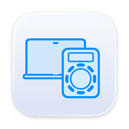

# AirmaiDX

AirmaiDX is a macOS launcher for rhythm-game installations you already have. It opens the folder you select, including folders on an external SSD, and keeps the compatibility environment and diagnostics on your Mac.

- Set the game’s display mode and render resolution independently.
- Use a mouse or a supported controller. Input support varies by controller and game version.
- Browse songs, preview charts, and manage supported chart data in your local library.
- Pair a compatible iPhone reader over your local network.

## Install

Download the DMG from [Releases](https://github.com/finnoscar/AirmaiDX/releases). Drag AirmaiDX into Applications, open it, and select your game folder. The first setup asks before downloading Wine, DXMT, and the Visual C++ runtime directly from their publishers. Allow about 355 MB of downloads, plus disk space for the installed runtime and per-game environment.

The preview requires an Apple silicon Mac, macOS 15 or later, and Rosetta 2 for the Windows runtime. The DMG is ad hoc signed and is not notarized. If macOS blocks a verified copy, see [Apple’s instructions for opening apps from outside the App Store](https://support.apple.com/102445).

AirmaiDX does not provide game files, accounts, machine credentials, or game services. Bring an installation you are authorized to use. This is an independent project and is not affiliated with SEGA.

## Development

See [Architecture](docs/ARCHITECTURE.md), [Build and test](docs/BUILDING.md), and [Third-party notices](docs/THIRD_PARTY_NOTICES.md).

AirmaiDX source is available under the [MIT License](LICENSE). Third-party components retain their own licenses. The project name and artwork identify the project and do not imply endorsement by another party.
